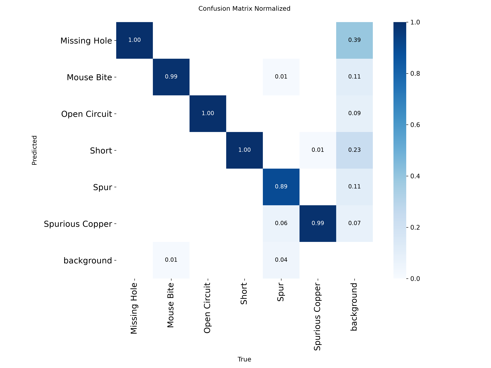

# PCB-Defect-Detection
A computer vision project detecting defects in printed circuit boards (PCBs) using basic vision techniques and yolo8n

## Note

This project is inspired by and builds upon the research presented in the following paper:
[https://huggingface.co/papers/1901.08204](https://huggingface.co/papers/1901.08204)
<br> We would like to thank the authors for making their research publicly available. Their work provides a valuable foundation for our project. While our implementation follows the original research in several aspects, we introduce some modifications and explore its application to additional problems.

## Dataset
We also found a dataset in another repository that is relevant to our research topic. It may serve as a useful resource for experimentation and further development.
<br> You can download the dataset from: [https://pan.baidu.com/s/1eAxDF4txpgMInxbmNDX0Zw](https://pan.baidu.com/s/1eAxDF4txpgMInxbmNDX0Zw) *extraction code:* `a6rh`
<br>Please refer to the original source for further information about the dataset, including its contents, usage conditions, and licensing terms.

## Features

- Automatic PCB defect detection
- YOLOv8n object detection model
- Multiple defect classification
- Bounding box visualization
- Confidence score prediction
- Fast inference
- Computer Vision based inspection

## Defect Classes

The model detects six PCB defects:

| Class |
|--------|
| Mouse Bite |
| Spur |
| Missing Hole |
| Short |
| Open Circuit |
| Spurious Copper |

## Install

The recorded environment is Python 3.14.6 with PyTorch 2.14.1+cu126 and Ultralytics 8.4.194. The requirements file pins the two versions supplied for that environment; it is not a complete `pip freeze` export because the full package list from that machine is not available here.

```bash
git clone https://github.com/YOUR_USERNAME/PCB-Defect-Detection.git
cd PCB-Defect-Detection
python -m venv .venv
source .venv/bin/activate
python -m pip install --upgrade pip
python -m pip install -r requirements.txt
```

The pinned PyTorch wheel uses CUDA 12.6. For a CPU-only or different CUDA environment, install the matching PyTorch build and update `requirements.txt` accordingly.

## Train and Eval

Download and extract the PCB defect dataset. `data/io/divide_data.py` expects the source directory to contain `images/` and `Annotations/`, each with one subdirectory per defect class. Image names must start with the board ID, for example `01_...jpg`.

Create the board-level train/validation/test dataset using the checked-in manifest:

```bash
python data/io/divide_data.py \
	--source PCB_DATASET \
	--output dataset/pcb_boards_yolo \
	--config configs/data_board.yaml \
	--manifest configs/board_split.json
```

Train YOLOv8s on the board-level split. Ultralytics downloads `yolov8s.pt` if it is not already available:

```bash
python tools/train.py \
	--name pcb_v8s_board \
	--model yolov8s.pt \
	--data configs/data_board.yaml \
	--imgsz 1024 \
	--batch 8 \
	--epochs 100 \
	--patience 30 \
	--workers 0 \
	--seed 0 \
	--device 0
```

Training weights are written to `runs/detect/pcb_v8s_board/weights/`; run parameters are appended to `configs/train_params.md`.

Evaluate on validation data during development:

```bash
python tools/eval.py \
	--weights runs/detect/pcb_v8s_board/weights/best.pt \
	--data configs/data_board.yaml \
	--split val \
	--name pcb_v8s_board \
	--imgsz 1024 \
	--batch 8 \
	--device 0
```

Per-class metrics and plots are written under `results/pcb_v8s_board_val/`. The held-out test set should be evaluated only for final reporting. This script refuses to overwrite an existing `results/test_metrics.csv`; pass `--split test --force` only when intentionally rerunning the test evaluation.

## Demo

Put one or more supported image files in `input/`, then run prediction with the trained checkpoint:

```bash
yolo predict \
	model=runs/detect/pcb_v8s_board/weights/best.pt \
	source=input \
	imgsz=1024 \
	device=0 \
	project=output \
	name=pcb_v8s_board
```

Annotated predictions are saved under `output/pcb_v8s_board/`. Use `device=cpu` on a machine without a compatible NVIDIA GPU.

## Some results

Validation results below are from the recorded experiments in `results/summary.csv`. The board split keeps boards separate across train, validation, and test; the random split is shown as a comparison.

| Run | Split | P | R | mAP50 | mAP50-95 | ms/image |
|---|---|---:|---:|---:|---:|---:|
| `pcb_v8n_random` | Random | 0.9702 | 0.9333 | 0.9668 | 0.5293 | 13.60 |
| `pcb_v8s` | Random | 0.9728 | 0.9473 | 0.9672 | 0.5437 | 24.90 |
| `pcb_v8n_board` | Board | 0.9728 | 0.9165 | 0.9722 | 0.5195 | 15.90 |
| `pcb_v8s_board` | Board | 0.9752 | 0.9582 | 0.9782 | 0.5507 | 28.84 |

The selected `pcb_v8s_board` checkpoint was evaluated once on the held-out test split (120 images, 601 objects): P 0.8543, R 0.9336, mAP50 0.9720, and mAP50-95 0.5162 at 31.91 ms/image. Test metrics are in `results/test_metrics.csv`; per-class results are in `results/pcb_v8s_board_test/metrics_per_class.csv`. On test, Mouse Bite and Short had lower precision (0.6272 and 0.6130), while Open Circuit had lower recall (0.7138).



## Acknowledgements

<br> We would like to thank the authors of the original research for making their work publicly available. Their research provides a valuable foundation for this project.
<br> Our implementation follows the original work in several aspects while introducing modifications to explore its applicability to additional problems.
<br> We encourage readers to consult the original paper and reference repository for further details.
